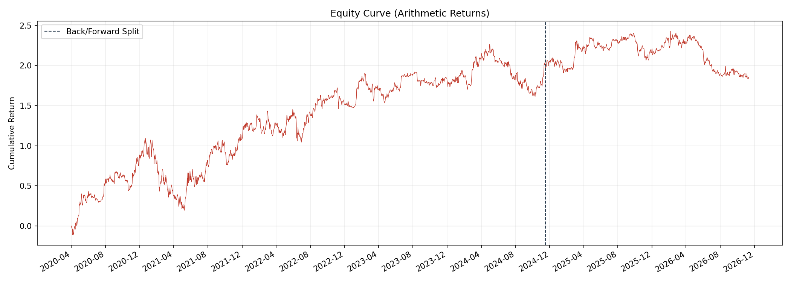
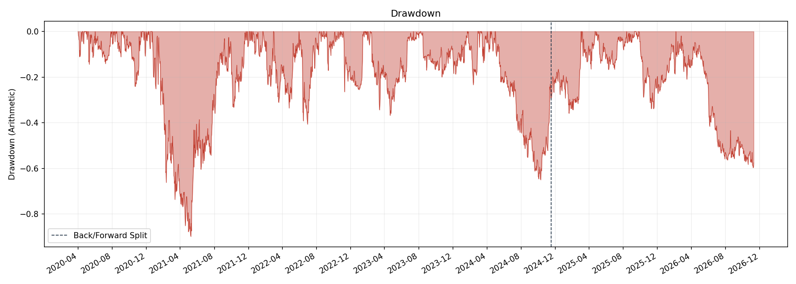
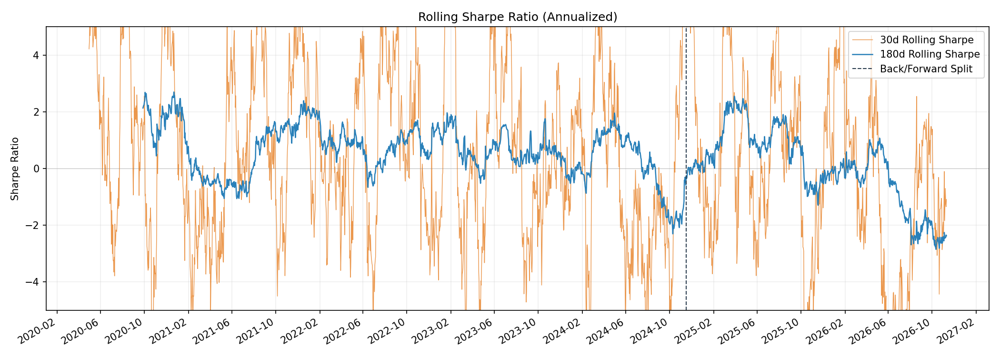
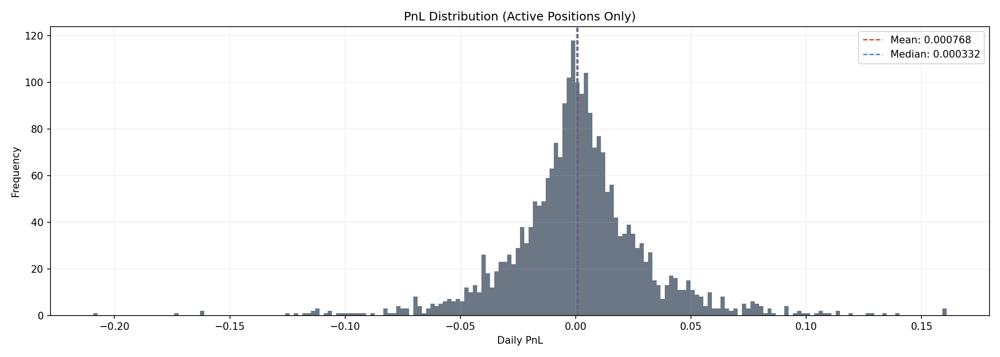
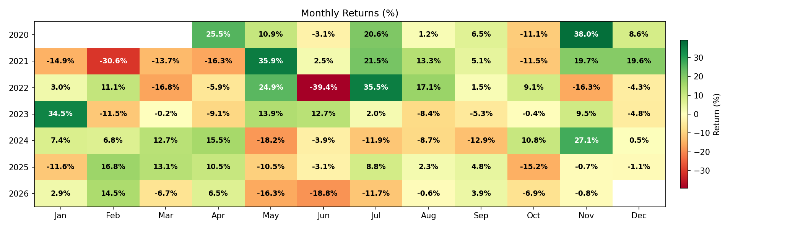

# BTC Funding Rate Momentum

## Alpha Hypothesis

The strategy trades the **trend in the aggregate BTC perpetual funding rate**.
Funding is the price leveraged traders pay to hold a directional position, so a
sustained rise in funding means leveraged long demand is building; a sustained
fall means long demand is fading or shorts are taking control. The strategy buys
BTC when funding has risen materially over the past 30 days and shorts it when
funding has fallen materially, holding the position until the trend reverses.

The implied counterparty is the late trend participant and the liquidity provider
who leans against a building flow too early. When funding keeps rising, late
shorts are paying an increasingly expensive carry and are eventually forced to
cover; the momentum trader is on the other side of that forced flow. The same
logic runs in reverse when funding collapses and crowded longs are liquidated.

The signal is deliberately slow (30-day change against a 90-day volatility
normalisation) because funding is highly autocorrelated and daily values are
noisy. A fast signal would mostly trade microstructure noise and pay fees.

## Parameters

| Parameter | Value |
|-----------|-------|
| Momentum lookback | 30 days |
| Volatility window | 90 days |
| Entry / exit z-score | ±0.5 |
| Position | +1 long, -1 short, hold inside the band |
| Funding lag | 1 day (end-of-day aggregate) |

## Data

- **Signal**: `cryptoquant|btc/market-data/funding-rates?window=day&exchange=all_exchange`
- **Evaluation**: `bybit-linear|candle?symbol=BTCUSDT&interval=1h`
- **Period**: 2020-04-01 to 2026-11-11 (70/30 back/forward split)
- **Fees**: 3.5 bps per trade, 1-hour price shift
- **Resolution**: 1 day

The daily CryptoQuant funding value is the **mean of the hourly values for that
calendar day** (verified directly against the hourly endpoint), so it is only
known after the day closes. The alpha uses `funding_rate.shift(1)` before
computing momentum; using the same-day value would be a full day of look-ahead.

## Backtest Results (2020-04 to 2024-11)

| Metric | Value |
|--------|-------|
| Total Return (%) | 197.38% |
| Annualised Avg Return | 42.60% |
| CAGR (%) | 25.20% |
| Sharpe Ratio | 0.67 |
| Sortino Ratio | 0.97 |
| Calmar Ratio | 0.47 |
| Max Drawdown (MDD, %) | -89.78% (arithmetic); -42.90% compounded |
| MDD Recovery Time (days) | 334 |
| MDD start & end date | 2020-12-23 to 2021-05-09 |
| Avg Position Holding Time | 13.1 days |
| Max Position Holding Time | 82.0 days |
| Win Trades | 128 |
| Lose Trades | 130 |
| Win Rate (%) | 49.61% |
| Winning Streak | 7 |
| Losing Streak | 4 |
| Largest Win (%) | 16.08% |
| Largest Loss (%) | -20.93% |
| Long Trades | 130 |
| Short Trades | 129 |
| Long-Short Ratio | 1.01 |
| Trade Count | 259 |

## Forward Test Results (2024-11 to 2026-11)

| Metric | Value |
|--------|-------|
| Total Return (%) | -11.97% |
| Annualised Avg Return | -6.03% |
| CAGR (%) | -14.03% |
| Sharpe Ratio | -0.14 |
| Sortino Ratio | -0.20 |
| Calmar Ratio | -0.10 |
| Max Drawdown (MDD, %) | -59.65% (arithmetic); -41.00% compounded |
| MDD Recovery Time (days) | 277 |
| MDD start & end date | 2026-02-06 to 2026-11-08 |
| Avg Position Holding Time | 11.3 days |
| Max Position Holding Time | 48.0 days |
| Win Trades | 68 |
| Lose Trades | 60 |
| Win Rate (%) | 53.13% |
| Winning Streak | 7 |
| Losing Streak | 4 |
| Largest Win (%) | 12.85% |
| Largest Loss (%) | -10.16% |
| Long Trades | 65 |
| Short Trades | 64 |
| Long-Short Ratio | 1.02 |
| Trade Count | 129 |

## Visualizations

### Equity Curve

The backtest period compounds to roughly +197% by late 2024, with positive
calendar-year returns in every year from 2020 to 2024. After the dashed split
the curve adds about +14% in 2025, then gives back -34% in 2026 and ends at -12%.

### Drawdown

The largest backtest drawdown is the 2021 episode: a -89.8% arithmetic peak-to-
trough that takes until November 2021 to recover. The forward period is worse in
character: a drawdown that begins in February 2026 and is still near its trough
in November 2026, at -59.7% arithmetic (-41.0% compounded).

### Rolling Sharpe Ratio

The 30-day Sharpe oscillates violently between roughly -10 and +9, which is
expected for a strategy that holds one unit long or short and trades only a few
times a month. The 180-day Sharpe is positive for about two-thirds of the
backtest, strongest through 2022-2023, fades toward zero in 2024, and turns
decisively negative through most of 2026. The signal did not decay gently — it
changed regime.

### PnL Distribution

Active-position daily PnL has a slightly positive mean (+0.00077) and median
(+0.00033) but very fat tails. The largest single-day loss (-20.9%) is far larger
than the largest gain (+16.1%), and the left tail is what drives the forward
drawdown. Win rate is essentially a coin flip (49.6% back, 53.1% forward), so the
result depends on a small number of large directional days rather than a stable
hit-rate edge.

### Monthly Returns

The heatmap shows the concentration of the backtest return: strong greens in
2020-11 (+38%), 2021-05 (+36%), 2022-07 (+36%), and 2023-01 (+35%), offset by
sharp red months such as 2022-06 (-39%) and 2021-02 (-31%). 2025 is mixed but
positive overall; in 2026 red months dominate, with the forward drawdown spread
across 2026-05 and 2026-06. There is no stable seasonal or monthly pattern.

## Evaluation

**Verdict: Not viable.**

The strategy looks acceptable in the backtest — Sharpe 0.67, CAGR 25%, roughly
symmetrical long/short activity — but it fails out of sample: Sharpe -0.14,
CAGR -14%, and a forward drawdown of -41% compounded that has not recovered.
That is not a mild degradation; it is a sign that the funding-momentum effect
captured in 2020-2024 did not persist into 2025-2026.

Several things make the backtest weaker than its headline numbers suggest:

1. **A structural break in the forward window.** The backtest is not a
   single-regime artifact in-sample — every calendar year 2020-2024 is positive
   — but the forward period is +14% in 2025 followed by -34% in 2026. The edge
   disappeared abruptly rather than decaying, which points to a change in how
   funding trends map to price rather than to ordinary alpha decay.
2. **Few effective bets.** 259 trades over 4.6 years, with an average holding
   period of 13 days, is a small sample. The 0.67 Sharpe is not statistically
   strong enough to rule out luck even before the forward test.
3. **Carry is not modelled.** Trading a perpetual future long while funding is
   positive means paying funding. The evaluator charges trading fees but not
   funding carry. Since the signal is long when funding is rising, the true net
   return is lower than reported.
4. **Cross-venue signal, single-venue execution.** The signal aggregates funding
   across exchanges, while execution is on Bybit. A venue-matched funding series
   (`exchange=bybit`) would be the cleaner test.
5. **Parameter selection.** The 30/90-day windows and ±0.5 band were chosen on the
   backtest window. The forward result is the honest out-of-sample check, and it
   says no.

**What would need to change:** the idea is not obviously wrong, but this
implementation does not isolate a durable edge. A next attempt should (a) model
funding carry in the PnL, (b) use venue-matched funding, (c) condition the
momentum signal on a price/volatility regime so it does not stay long into a
funding collapse, and (d) test the signal on a panel of assets or a longer
history to see whether the effect is real or a BTC-specific 2020-2022 artifact.
Until one of those survives a fresh out-of-sample window, this alpha should not
go to portfolio construction.
